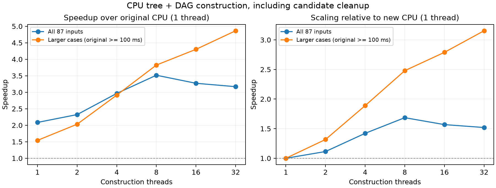

# CPU parallel extraction — 2026-11-12

| Artifact | Contents |
|---|---|
| [87-design comparison tables](comparison.md) | Paper XEG versus CPU overall runtime and final cost, followed by separate CPU tree and DAG scaling tables |
| [Construction timing tables](construction.md) | Separate tree and DAG runtimes at 1, 2, 4, 8, 16, and 32 threads, with speedups relative to 1 thread |
| [Comparison data](comparison.csv) | Exact values used by the comparison tables |
| [Paper XEG baseline](paper_xeg.csv) | XEG runtime and final cost transcribed from Table 8 |
| [Full report](REPORT.txt) | Implementation, measurement settings, correctness checks, results, and limitations |
| [Performance plot](performance.png) | CPU tree and DAG construction speedup across thread counts |
| [Per-input costs](quality.csv) | Paper, original CPU, delivered CPU, and fixed-budget verification costs and solver statuses |

The full report distinguishes construction timing, timed solver quality, and
fixed-budget reproducibility. It also records the remaining differences from the
paper's costs.

`REPORT.txt`, `performance.png`, and `quality.csv` are exact copies of the experiment artifacts in
`build/plan/20261112_cpu_parallel/`. Other logs and evidence paths mentioned in
the report refer to that local experiment directory.
