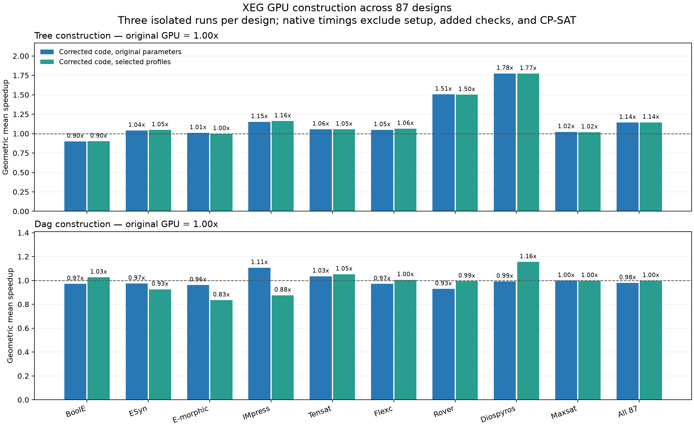

# GPU extraction results

- [CPU 8 threads / GPU / GPU (common settings): overall runtime and solution quality across 87 designs](overall_runtime.md), with [matching costs, statuses, and source paths](overall_runtime.csv)
- [GPU: quality and separate tree/DAG tables](profiled.md)
- [Fixed original parameters: implementation-only comparison](comparison.md)
- [Full report and experiment limits](REPORT.txt)
- [Per-design costs](quality.csv), [full measurements](profiles.csv), [profile settings](profiles.json)
- [All parameter-trial summaries, including rejected settings](profile_trials.csv)
- [Original INFEASIBLE diagnostics](infeasible_diagnostics.csv)

The overall-runtime table uses existing quality runs, including construction, in-program checks, and CP-SAT, but excluding JSON loading. CPU and GPU sweeps used different concurrent loads, and selected profiles reuse or select existing trials. These times are reference observations, not a controlled CPU/GPU speedup comparison; see the caveats in the table.

All 87 selected GPU solutions passed independent verification: 80 OPTIMAL, 7 FEASIBLE. Against the original GPU, native geometric-mean speedups are **1.145x tree** and **0.998x DAG**. 23 designs have slower tree timings and 44 have slower DAG timings; per-design results and added verification overhead are shown in the tables.

Selected quality versus the CPU reference: 17 lower, 51 equal, 19 higher; 0 without a reference answer. Profiles are chosen from measured trials and are not guaranteed optima or deterministic results. The fixed-parameter comparison remains separate to make the effect of tuning visible.

Validation: 139 C++/CUDA tests, 15 Python tests, 87 CPU regression comparisons, and GPU memcheck on tree/repeated-extraction tests. Raw experiment/review logs remain under `build/plan/20261112_gpu_alignment/` on the experiment server.

The GPU runner automatically selects saved settings for known inputs and common
settings for other inputs. The common-settings column is a retained experimental
reference, not a separate execution mode. Historical reports may call these
observations “Profiled GPU” and “Fixed GPU.” The measurements are unchanged.
See the [configuration guide](../../../configs/gpu/README.md#write-your-own-settings)
for custom JSON settings, including how to use one configuration for all inputs.
